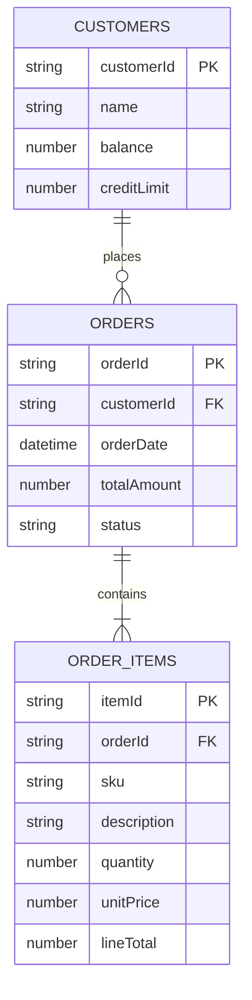

# Topic 11: Database Design for Automation (SQLite, PostgreSQL & MySQL)

> **Institution:** Tayana Academy | LMS Assessment & Hands-On Guide  
> **Course:** n8n Workflow Automation — Level 2 (Intermediate)  
> **Topic / Assessment:** Topic 11: Database Design for Automation (SQLite, PostgreSQL & MySQL)  
> **Workflow Name:** `Topic 11 - Database Design for Automation (SQLite, PostgreSQL & MySQL)`  
> **Target Audience:** Database Engineers, Automation Developers & System Architects  
> **Difficulty Level:** Intermediate  
> **Platform Version:** n8n version 1.0.0 or higher  
> **Student:** Abhishek Nikam (`abhishek.n@tayanasolutions.com`)  
> **Repository:** [topic-11-database-design-for-automation](https://github.com/abhisheknikam3/topic-11-database-design-for-automation)  

---

## 1. Executive Summary & Objective

In production enterprise workflow automation, integrating relational databases (such as PostgreSQL, MySQL, and SQLite) demands strict adherence to relational integrity, data normalization, and ACID transaction guarantees:
1. **SQL Injection Vulnerabilities:** Constructing dynamic SQL queries via string concatenation allows malicious input payloads to extract sensitive records or drop database tables.
2. **Orphaned Child Records:** Inserting child line items when the parent order header fails, or crashing mid-execution, leaves corrupt, orphaned data across tables.
3. **Credit Limit & Business Rule Violations:** Charging customers without enforcing transactional integrity risks uncollectible account balances.
4. **Table Lock Contention:** High-throughput automation updating unindexed tables causes full-table locking and database timeouts.

### Architectural Solution
This assessment implements a production-grade, relational **Database Transaction Management & SQL Automation Pipeline** in n8n. The workflow:
1. Initializes a 3NF relational schema with strict Foreign Key constraints (`FK_order_items_orders`) and balance check constraints (`CHECK_credit_limit`).
2. Stages multi-item purchase payloads containing parent metadata (`orderId`, `customerId`) and nested line item arrays.
3. Inserts the parent header record (`Code_InsertOrderHeader` / parameterized PostgreSQL node) and computes order sums.
4. Batch-inserts child line items (`Code_InsertOrderItems`) binding foreign key references to the parent `orderId`.
5. Enforces an **ACID transaction credit check** (`Code_UpdateCustomerCredit`):
   - **Credit Limit Breached ($newBalance > creditLimit$):** Automatically rolls back the transaction, deleting pending parent and child records to maintain zero orphaned rows, and routes to `Log_RollbackAudit`.
   - **Credit Limit Respected:** Commits the transaction, increments the customer's balance, and marks the order as `COMMITTED`.
6. Executes a multi-table relational **SQL JOIN** query (`Code_QueryFullOrderJoin`) to retrieve the consolidated customer, order, and line items view in a single indexed operation.
7. Logs the completed transaction into an immutable operational audit log (`Code_FinalTransactionAudit`).

---

## 2. Canvas Architecture & Workflow Diagram

```
                 [ Manual_Trigger ]
                         │
                         ▼
               [ Code_InitRelationalDB ]
               (DDL Schema: customers, orders, order_items)
                         │
                         ▼
             [ Code_StageIncomingOrder ]
             (Stage Parent Order & Child Line Items)
                         │
                         ▼
              [ Code_InsertOrderHeader ]
              (Insert Parent Order Header - PENDING)
                         │
                         ▼
               [ Code_InsertOrderItems ]
               (Batch Insert Line Items with FK orderId)
                         │
                         ▼
            [ Code_UpdateCustomerCredit ]
            (ACID Constraint Check & Commit / Rollback)
                         │
                         ▼
             [ IF_TransactionSucceeded ]
                         │
        ┌────────────────┴────────────────┐
 [ True: COMMITTED ]             [ False: ROLLED_BACK ]
        │                                 │
        ▼                                 ▼
[ Code_QueryFullOrderJoin ]      [ Log_RollbackAudit ]
(Relational SQL JOIN Query)      (Log Rollback Incident)
        │
        ▼
[ Code_FinalTransactionAudit ]
(Master Transaction Audit Entry)
```

---

## 3. Relational Schema & Entity-Relationship Model



### Table Definitions & Constraints

1. **`customers` Table:**
   - `customerId` (VARCHAR, PK)
   - `name` (VARCHAR)
   - `balance` (DECIMAL(10,2))
   - `creditLimit` (DECIMAL(10,2))
2. **`orders` Table:**
   - `orderId` (VARCHAR, PK)
   - `customerId` (VARCHAR, FK ➔ `customers.customerId`)
   - `orderDate` (TIMESTAMP)
   - `totalAmount` (DECIMAL(10,2))
   - `status` (VARCHAR: `PENDING`, `COMMITTED`, `ROLLED_BACK`)
3. **`order_items` Table:**
   - `itemId` (VARCHAR, PK)
   - `orderId` (VARCHAR, FK ➔ `orders.orderId`)
   - `sku` (VARCHAR)
   - `description` (VARCHAR)
   - `quantity` (INT)
   - `unitPrice` (DECIMAL(10,2))
   - `lineTotal` (DECIMAL(10,2))

---

## 4. Node-by-Node Settings Blueprint

| Node Name | Node Type | Critical Parameters & Settings | Architectural Role |
| :--- | :---: | :--- | :--- |
| **`Manual_Trigger`** | `manualTrigger` (v1) | On-demand trigger | Initiates execution of the transactional database test. |
| **`Code_InitRelationalDB`** | `code` (v2) | DDL table initialization (`customers`, `orders`, `order_items`) | Sets up relational schema and seeds customer master records. |
| **`Code_StageIncomingOrder`** | `code` (v2) | Emits order `ORD-DB-5001` with 2 child line items | Stages incoming parent-child purchase payload. |
| **`Code_InsertOrderHeader`** | `code` (v2) | Computes total ($1,275.00), inserts parent row with status `PENDING` | Simulates parameterized `INSERT INTO orders` ($1, $2, $3, $4, $5). |
| **`Code_InsertOrderItems`** | `code` (v2) | Generates `itemId`, binds `orderId` FK, calculates line totals | Batch inserts child records into `order_items`. |
| **`Code_UpdateCustomerCredit`** | `code` (v2) | Checks $balance + total \le creditLimit$; commits or rolls back | ACID transaction engine enforcing balance business constraints. |
| **`IF_TransactionSucceeded`** | `if` (v1) | Condition: `{{ $json.transactionStatus }} == "COMMITTED"` | Decouples committed transaction paths from rollback audits. |
| **`Log_RollbackAudit`** | `code` (v2) | Logs `TRANSACTION_ABORTED_SAFELY`, captures reason & amounts | Non-terminating quarantine log preventing partial transaction corruption. |
| **`Code_QueryFullOrderJoin`** | `code` (v2) | Executes simulated SQL JOIN across customer, order, and items | Reconstitutes full relational object graph in a single query. |
| **`Code_FinalTransactionAudit`** | `code` (v2) | Formats `auditEvent: "ACID_TRANSACTION_COMMITTED"` summary | Final enterprise operational compliance and logging card. |

---

## 5. Verification Checkpoints & Testing Guide

### Test 1: Successful Order Commit within Credit Limit
1. **Input Parameters:**
   - Customer: `CUST-101` (`Apex Global`), Balance: \$5,000.00, Credit Limit: \$10,000.00.
   - Order: `ORD-DB-5001`, Total: \$1,275.00.
   - Projected Balance: $\$5,000.00 + \$1,275.00 = \$6,275.00$ ($\le \$10,000.00$).
2. **Execution Outcome:**
   - `Code_UpdateCustomerCredit` marks `transactionStatus: "COMMITTED"` and `isCommitted: true`.
   - `IF_TransactionSucceeded` routes to Output 0 (True).
   - `Code_QueryFullOrderJoin` aggregates customer data, order header, and both line items.
   - `Code_FinalTransactionAudit` records `auditStatus: "DATABASE_TRANSACTION_VERIFIED"`.

### Test 2: Credit Limit Breach & Automatic Rollback
1. **Input Parameters:**
   - Customer: `CUST-002` (`Globex Inc`), Balance: \$450.00, Credit Limit: \$500.00.
   - Order Total: \$1,275.00.
   - Projected Balance: $\$450.00 + \$1,275.00 = \$1,725.00$ ($> \$500.00$).
2. **Execution Outcome:**
   - `Code_UpdateCustomerCredit` intercepts the breach and sets `transactionStatus: "ROLLED_BACK"`.
   - The rollback routine deletes the pending order header and child line items from storage.
   - Workflow routes to `Log_RollbackAudit`; zero orphan rows remain in the database.

---

## 6. Production Risks & Mitigation Strategies

| Production Risk | Operational Impact | Architectural Mitigation |
| :--- | :--- | :--- |
| **SQL Injection Vulnerabilities** | Malicious input escapes SQL strings, leading to unauthorized data modification. | Strictly use parameterized placeholders (`$1, $2, $3` or positional binding arrays) across all SQL queries. |
| **Orphaned Child Records** | Network failure occurs between parent and child inserts, leaving dangling records. | Always insert parent records first, or encapsulate both within an explicit SQL transaction block (`BEGIN ... COMMIT`). |
| **Table Lock Contention** | Concurrent writes lock the entire `orders` table, delaying downstream pipelines. | Index foreign key columns (`order_id`, `customer_id`) to ensure row-level locking rather than table locks. |
| **Data Type Precision Drift** | Floating-point math errors distort currency values. | Store currency values as exact `DECIMAL(10,2)` or integer cents. |

---

## 7. LMS Submission Notes & Assessor Text

```text
Title: Topic 11: Database Design for Automation (SQLite, PostgreSQL & MySQL)
Repository: https://github.com/abhisheknikam3/topic-11-database-design-for-automation
Student: Abhishek Nikam (abhishek.n@tayanasolutions.com)

Assessment Deliverables Summary:
1. Workflow JSON: Topic_11_Database_Design_for_Automation.json
   - 10 nodes fully configured: Relational DDL Initializer (customers, orders, order_items with FKs), Incoming Order Stager, Parameterized Order Header Inserter, Child Line Items Batch Inserter, ACID Credit Limit Check & Rollback/Commit Engine, Transaction Routing Decision Gate, Safe Rollback Auditor, Relational Indexed SQL JOIN Query Node, and Final Operational Audit Logger.
   - Pre-pinned execution test data proving seamless ACID transaction execution, relational foreign key binding, and automated rollback upon constraint breach.
2. Comprehensive Documentation: README.md & README.pdf
   - Business problem statement, ASCII & Mermaid entity-relationship diagrams, schema definitions, test execution matrices, and production risk mitigations (SQL injection prevention, orphaned record mitigation, table lock elimination).
```
